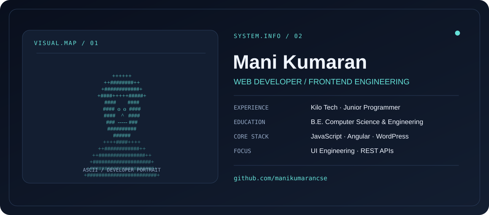

<picture>
  <source media="(prefers-color-scheme: dark)" srcset="./dark.svg" />
  <source media="(prefers-color-scheme: light)" srcset="./light.svg" />
  
</picture>

  

  
  
  
  

  

---

## 🔴 About Me

  

  

  Hey! I'm <b>Mani Kumaran</b>, a <b>Junior Programmer & Front-End Developer</b> based in Chennai, India. 
  I have 2 years of professional experience designing, building, and deploying responsive web applications[cite: 2]. I specialize in front-end architecture using <b>AngularJS, HTML5, CSS3, and JavaScript</b>, along with dynamic data handling using <b>PHP and RESTful APIs</b>[cite: 2].

  
  
  

  💬 <b>Let's Discuss:</b> AngularJS, Responsive UI, Bootstrap, Tailwind CSS, REST APIs, PHP & Custom WordPress Theming[cite: 2]. 
  ⚡ <b>Philosophy:</b> <i>"Committed to clean code, modular architecture, and turning ideas into smooth digital experiences!"</i>

---

## 💼 Work Experience

### **Junior Programmer** — *Kilo Tech*[cite: 2]
*January 2024 – February 2026 · Chennai, India*[cite: 2]

* Engineered and maintained responsive web interfaces using HTML, CSS, JavaScript, and AngularJS, ensuring cross-browser compatibility[cite: 2].
* Integrated RESTful APIs and PHP programs for dynamic data fetching and seamless application updates[cite: 2].
* Optimized front-end components and modular code for performance, resulting in faster load times across core views[cite: 2].

---

## 🚀 Featured Projects & Live Demos

| Project | Highlights | Links |
| :--- | :--- | :--- |
| **📦 BottleBook** | Responsive bottle management web application with dynamic task and inventory tracking[cite: 2]. | [Live Demo](https://bottlebook-91f09.web.app/) · [GitHub](https://github.com/manikumarancse)[cite: 2] |
| **🎸 Guitar Training Haus** | End-to-end client website built with custom WordPress theming and deployed via InfinityFree[cite: 2]. | [Visit Site](http://guitartraininghaus.free.nf/)[cite: 2] |
| **🏏 Cricket Score Tracker** | Interactive scoreboard updating match statistics, overs, and wickets live via DOM manipulation[cite: 3]. | [Live Demo](https://manikumarancse.github.io/Cricket-Score/) · [Source](https://github.com/manikumarancse/Cricket-Score)[cite: 3] |
| **📝 Task Management App** | Client-side task tracker featuring persistent state management via browser LocalStorage[cite: 2]. | [Live Demo](https://manikumarancse.github.io/To-Do-App/) · [Source](https://github.com/manikumarancse/To-Do-App)[cite: 2] |

---

## 🛠️ Tech Stack & Skills

<b>Core Programming Languages</b>

  

<b>Frontend & UI Styling</b>

  

<b>Databases, Backend & Web Hosting</b>

  

<b>Tools & Design</b>

  

---

## 📊 GitHub Analytics & Activity

  

---

## ⚡ Contribution Journey

  

---

## 📬 Let's Connect & Collaborate

<i>Whether you'd like to collaborate on web projects, discuss front-end architecture, or talk tech — my inbox is always open!</i>

<table border="0" align="center">
  <tr>
    <td align="center" width="220" style="padding: 16px;">
      <a href="https://linkedin.com/in/mani-kumaran-04871a275" target="_blank">
          
        
      </a>
       
      <b>Professional Network</b>
    </td>
    <td align="center" width="220" style="padding: 16px;">
      <a href="https://portfolio-7eb17.web.app/" target="_blank">
          
        
      </a>
       
      <b>Live Projects & Works</b>
    </td>
    <td align="center" width="220" style="padding: 16px;">
      <a href="mailto:manikumaran.dev@gmail.com">
          
        
      </a>
       
      <b>Direct Contact</b>
    </td>
  </tr>
</table>

 

Theme-adaptive header loaded directly from <code>./dark.svg</code> and <code>./light.svg</code>[cite: 5]

